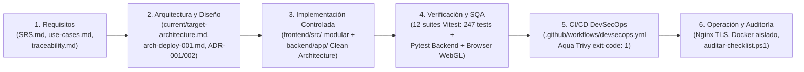

# Matriz de Conformidad con Normas Internacionales ISO (`ISO/IEC 25010`, `ISO/IEC 12207` e `ISO/IEC 27001`)

**Proyecto:** La Búsqueda del Ídolo Perdido
**Asignaturas:** Creación de Entornos Multimedia · Sistemas de Comunicación y Seguridad Informática
**Rama / Estado:** `dev/jesus` — Sincronizado con la arquitectura cliente-servidor (`12 suites / 247 pruebas en Vitest` + `Pytest` en Backend)

---

## 1. Propósito y Alcance de la Evaluación

Este documento establece la trazabilidad técnica del proyecto frente a tres estándares internacionales de referencia en Ingeniería y Seguridad de Software, distinguiendo con rigor qué evidencias están verificadas mediante pruebas automatizadas en el repositorio y cuáles corresponden a procedimientos de validación en el entorno de despliegue/laboratorio:
1. **ISO/IEC 25010 (SQuaRE — System and Software Quality Requirements and Evaluation):** Modelo de calidad del producto de software en sus 8 características.
2. **ISO/IEC 12207 e ISO/IEC 29110:** Procesos del Ciclo de Vida del Software (SDLC) desde la ingeniería de requisitos hasta la verificación, integración continua y operación.
3. **ISO/IEC 27001 / ISO/IEC 27002 (Anexo A):** Controles de Seguridad de la Información aplicados en las Semanas 1 a 10 del sílabo.

---

## 2. Evaluación de Calidad del Producto según `ISO/IEC 25010`

| Característica ISO/IEC 25010 | Subcaracterísticas Evaluadas | Requisito SRS | Estado | Artefactos y Evidencia Verificable |
|---|---|---|---|---|
| **1. Adecuación Funcional** | Completitud, corrección y pertinencia funcional | `RF-001` a `RF-009` | **CUMPLIDO** | 3 biomas 3D jugables, diálogo con NPC Daniel, combate anatómico, supervivencia al frío, cinemáticas, cuentas y persistencia en backend trazados en [SRS.md](file:///c:/Estudio/Seguridad-Multimedia/docs/requirements/SRS.md) y [traceability.md](file:///c:/Estudio/Seguridad-Multimedia/docs/requirements/traceability.md). |
| **2. Eficiencia de Desempeño** | Comportamiento temporal y utilización de recursos | `RNF-001` | **CUMPLIDO** | Delta acotado (`dt <= 0.05 s`), resolución dinámica en [detalle.js](file:///c:/Estudio/Seguridad-Multimedia/frontend/src/juego/detalle.js) y cotas `mem_limit` / `cpus` en [compose.raspberry.yaml](file:///c:/Estudio/Seguridad-Multimedia/compose.raspberry.yaml). |
| **3. Compatibilidad** | Coexistencia e interoperabilidad | `RNF-004`, `ARCH-DEPLOY-001` | **CUMPLIDO** | Interoperabilidad entre Frontend SPA y API REST `/api/v1` (OpenAPI 3.1) mediante [apiCliente.js](file:///c:/Estudio/Seguridad-Multimedia/frontend/src/cuenta/apiCliente.js); imágenes Docker multi-arquitectura (`linux/arm64` y `linux/amd64`). |
| **4. Usabilidad** | Operabilidad, protección contra errores de usuario y accesibilidad | `RF-002`, `RNF-004` | **CUMPLIDO** | Soporte automático teclado/ratón + controles táctiles ([tactil.js](file:///c:/Estudio/Seguridad-Multimedia/frontend/src/interfaz/tactil.js)), atributos ARIA (`role="dialog"`, `aria-modal`, `prefers-reduced-motion`) en [pantalla.js](file:///c:/Estudio/Seguridad-Multimedia/frontend/src/cuenta/pantalla.js) y [responsivo.css](file:///c:/Estudio/Seguridad-Multimedia/frontend/src/interfaz/responsivo.css). |
| **5. Fiabilidad** | Madurez, disponibilidad, tolerancia a fallos y capacidad de recuperación | `RF-001`, `SEG-002`, `SEG-006` | **CUMPLIDO** | Manejo de errores WebGL en [main.js](file:///c:/Estudio/Seguridad-Multimedia/frontend/src/main.js), autorrecuperación a Nivel 1 ante adulteración en BD (`test_db_hmac_tampering_auto_resets_to_level_1`), `healthcheck` en contenedores, contingencia AAA (`group radius local`) y mitigación DoS con `limit_req_zone` (`HTTP 429`). |
| **6. Seguridad** | Confidencialidad, integridad, no repudio, responsabilidad y autenticidad | `SEG-001` a `SEG-007` | **CUMPLIDO** | `Argon2id` + `PBKDF2-SHA256`, `HMAC-SHA256`, manifiesto `SHA-256` ([sha256-manifest.json](file:///c:/Estudio/Seguridad-Multimedia/deploy/security/sha256-manifest.json)), TLS 1.2/1.3, cookies `HttpOnly; Secure`, CSRF, anti-spoofing IP, RBAC, bitácora SIEM `security_audit_logs` y pipeline **Aqua Trivy** ([checklist-cumplimiento-semanas-1-10.md](file:///c:/Estudio/Seguridad-Multimedia/docs/security/checklist-cumplimiento-semanas-1-10.md)). |
| **7. Mantenibilidad** | Modularidad, reusabilidad, analizabilidad, capacidad de ser modificado y probado | `RNF-002`, `RNF-003` | **CUMPLIDO** | Separación por dominios en `frontend/src/`, **Clean Architecture de 4 capas** en [backend/app/](file:///c:/Estudio/Seguridad-Multimedia/backend/app/main.py), FSM desacoplada bajo `ADR-001`/`ADR-002` y **12 suites con 247 pruebas automatizadas en Vitest** + suite `Pytest` en backend. |
| **8. Portabilidad** | Adaptabilidad e instalabilidad | `ARCH-DEPLOY-001` | **CUMPLIDO** | Despliegue unificado mediante perfiles Docker Compose para desarrollo local (`compose.local.yaml`), laboratorio Raspberry Pi (`compose.raspberry.yaml`) y VPS en producción (`compose.vps.yaml`). |

---

## 3. Cumplimiento del Ciclo de Vida del Software (`ISO/IEC 12207` / `ISO/IEC 29110`)

| Proceso del Ciclo de Vida (`ISO/IEC 12207`) | Artefactos de Evidencia en el Repositorio | Estado de Conformidad |
|---|---|---|
| **Proceso de Definición de Requisitos del Sistema y Software** | [docs/requirements/SRS.md](file:///c:/Estudio/Seguridad-Multimedia/docs/requirements/SRS.md), [docs/requirements/use-cases.md](file:///c:/Estudio/Seguridad-Multimedia/docs/requirements/use-cases.md), [docs/requirements/traceability.md](file:///c:/Estudio/Seguridad-Multimedia/docs/requirements/traceability.md) | **CONFORME** (Actores `ACT-001..006`, Casos de Uso `CU-001..019`, Requisitos `RF`, `SEG`, `RNF` sin conflictos documentales). |
| **Proceso de Definición de la Arquitectura y Diseño** | [docs/architecture/current-architecture.md](file:///c:/Estudio/Seguridad-Multimedia/docs/architecture/current-architecture.md), [docs/architecture/target-architecture.md](file:///c:/Estudio/Seguridad-Multimedia/docs/architecture/target-architecture.md), [docs/architecture/arch-deploy-001.md](file:///c:/Estudio/Seguridad-Multimedia/docs/architecture/arch-deploy-001.md), [ADR-001.md](file:///c:/Estudio/Seguridad-Multimedia/docs/architecture/ADR/ADR-001.md), [ADR-002.md](file:///c:/Estudio/Seguridad-Multimedia/docs/architecture/ADR/ADR-002.md) | **CONFORME** (8 diagramas arquitectónicos Mermaid, Clean Architecture en 4 capas y decisiones arquitectónicas registradas). |
| **Proceso de Implementación e Integración** | `frontend/src/`, `backend/app/`, `backend/alembic/versions/0001_initial_schema.py` | **CONFORME** (Integración cliente-servidor sin almacenar credenciales en navegador y migraciones Alembic deterministas). |
| **Proceso de Verificación y Validación (V&V)** | [docs/quality/test-strategy.md](file:///c:/Estudio/Seguridad-Multimedia/docs/quality/test-strategy.md), [docs/quality/test-cases.md](file:///c:/Estudio/Seguridad-Multimedia/docs/quality/test-cases.md), [docs/quality/test-results.md](file:///c:/Estudio/Seguridad-Multimedia/docs/quality/test-results.md) | **CONFORME** (12 suites / 247 pruebas en Vitest pasando al 100 %, pruebas de seguridad en backend y compilación de producción verificada). |
| **Proceso de Gestión de Configuración y DevSecOps** | [.github/workflows/devsecops.yml](file:///c:/Estudio/Seguridad-Multimedia/.github/workflows/devsecops.yml), [compose.yaml](file:///c:/Estudio/Seguridad-Multimedia/compose.yaml), [deploy/scripts/auditar-checklist.ps1](file:///c:/Estudio/Seguridad-Multimedia/deploy/scripts/auditar-checklist.ps1) | **CONFORME** (Escaneo SAST/SCA e imágenes con Aqua Trivy y verificación criptográfica `SHA-256`). |

---

## 4. Correspondencia con Controles `ISO/IEC 27001:2022` (Anexo A)

| Control ISO/IEC 27001:2022 | Semana del Sílabo | Implementación en el Proyecto |
|---|---|---|
| **A.8.24 Uso de criptografía** | Semana 1 | `Argon2id`, `PBKDF2-HMAC-SHA256` (`150 000` iteraciones), `HMAC-SHA256` en BD y manifiesto `SHA-256` de activos ([security.py](file:///c:/Estudio/Seguridad-Multimedia/backend/app/core/security.py), [sha256-manifest.json](file:///c:/Estudio/Seguridad-Multimedia/deploy/security/sha256-manifest.json)). |
| **A.8.20 / A.8.21 Seguridad de redes y servicios de red** | Semanas 2, 3 y 6 | TLS 1.2/1.3 en [nginx.conf](file:///c:/Estudio/Seguridad-Multimedia/deploy/nginx/nginx.conf), WiFi WPA3-AES en [wpa3-aes-supplicant.conf](file:///c:/Estudio/Seguridad-Multimedia/deploy/network/wpa3-aes-supplicant.conf) y firewall `Default Deny` bidireccional en [firewall-default-deny.sh](file:///c:/Estudio/Seguridad-Multimedia/deploy/network/firewall-default-deny.sh). |
| **A.8.22 Segregación en redes** | Semana 3 | VLANs estructuradas (`VLAN 10` con `ip access-group ACL_USUARIOS_A_SERVIDORES in`, `VLAN 20`, `VLAN 99`) en [cisco-ios-vlans-aaa-radius.cfg](file:///c:/Estudio/Seguridad-Multimedia/deploy/network/cisco-ios-vlans-aaa-radius.cfg) y subred Docker `backend_net` (`internal: true`) en [compose.yaml](file:///c:/Estudio/Seguridad-Multimedia/compose.yaml). |
| **A.5.15 / A.8.5 Control de acceso y autenticación segura** | Semana 4 | IAM centralizado en FastAPI, Zero Trust, RBAC, protección CSRF, anti-spoofing de IP y contingencia AAA (`aaa authentication login default group radius local`). |
| **A.8.9 Gestión de configuración y Hardening** | Semana 5 | `server_tokens off;`, cabeceras HTTP defensivas en todas las rutas (incluido `/models/`) y contenedores sin privilegios (`UID 10001`, `cap_drop: ALL`). |
| **A.8.25 / A.8.28 / A.8.29 Ciclo de vida de desarrollo seguro y pruebas de seguridad** | Semanas 7 y 8 | Pipeline CI/CD con **Aqua Trivy** ([.github/workflows/devsecops.yml](file:///c:/Estudio/Seguridad-Multimedia/.github/workflows/devsecops.yml)) y playbook de pentesting con **Nmap NSE** (`--script vuln`) en [raspberry-pentest-playbook.md](file:///c:/Estudio/Seguridad-Multimedia/docs/security/raspberry-pentest-playbook.md). |
| **A.8.6 Gestión de capacidad y resiliencia ante DoS** | Semanas 9 y 10 | `ngx_http_limit_req_module` (`limit_req_zone` y `burst`), respuestas `HTTP 429` al tráfico abusivo y preservación de disponibilidad `HTTP 200 OK` documentada con Apache Benchmark (`ab`). |
